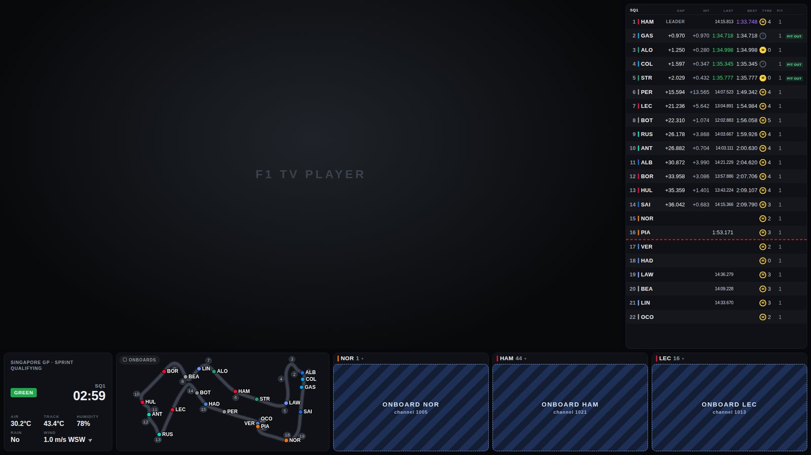
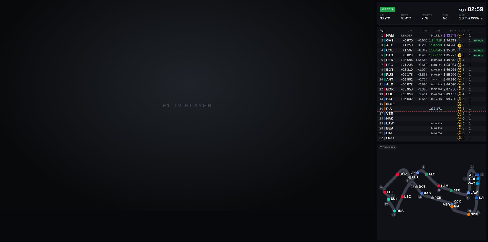
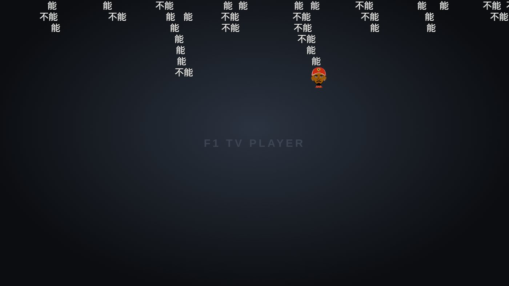
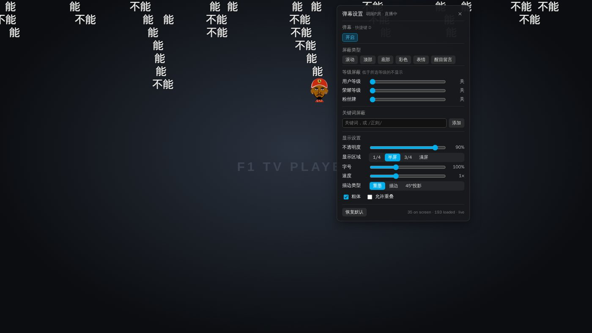

# f1tv-bilibili-sync — F1 TV with a Bilibili streamer's commentary

Watch **F1 TV** with a Bilibili streamer's commentary instead of the official broadcast, live or
as a replay. Scrub, pause, seek or watch at 2×: the commentary follows the picture. Next to the
video there's a live timing tower, a track map, driver onboards, and the streamer's live-room
**弹幕** scrolling over the picture, in step with what you hear. It is built around one streamer,
**胡闹P房**, as the worked example: every setting below is theirs, and
[Using it with another streamer](#using-it-with-another-streamer) lists what to change.

<p align="center">
  
</p>

It's two parts: a **server** (Python, Docker) that turns the streamer's recordings into
commentary you can play from any moment, and a **Chrome extension** that hooks into F1 TV's
player and plays the right commentary for whatever is on screen. Inside, the project is called
**fone**: the server package, the Docker containers and volume, the extension and the install
paths all go by that name.

- [What it does](#what-it-does)
- [How it works](#how-it-works)
- [Setup](#setup)
- [Using it](#using-it)
- [Configuration](#configuration)
- [Using it with another streamer](#using-it-with-another-streamer)
- [Server API](#server-api)
- [Development](#development)
- [Repository layout](#repository-layout)
- [Privacy and security](#privacy-and-security)
- [Limitations](#limitations)
- [Status, licence and trademarks](#status-licence-and-trademarks)

## What it does

**Commentary in sync**
- **Replays sync themselves.** MultiViewer publishes where the official `SessionStatus: Started`
  moment falls in each F1 TV replay, and F1 live timing gives its UTC time. Every 2026 session
  checks out to under 0.5 s. Until MultiViewer publishes (live, or just after a session), fone
  uses the replay's fixed pre-roll (307 s for qualifying and races, 250 s for sprints, ~1165 s for
  practice).
- **The streamer's delay is measured, not guessed.** The streamer watches with MultiViewer's
  "Track time" on screen; the server reads that clock off their stream (tesseract OCR) to
  measure how far behind real time they are, per recording.
- **Live works edge to edge.** fone locks the commentary's live edge to F1 TV's. If F1 TV is
  ahead of the commentary it pauses the video until the commentary catches up, then keeps you just
  behind the streamer.
- **Seek, pause, 1.5×, 2×.** Speeds keep the commentary's pitch. F1 TV's player constantly nudges
  its real speed to stay in step with its own clock, by up to ±25%; fone tells those nudges apart
  from a real speed change, so the commentary doesn't click or jump.
- **F1 TV's own commentary out of the way.** By default fone mutes F1 TV's player: the recording
  already carries the streamer's F1 TV sound, and two copies of the same audio at any offset are an
  echo. Or it switches F1 TV to its commentary-free *Track FX* track on every video, if you prefer
  F1 TV's clean track sound.
- **Sponsor reels muted.** The streamer's pre-recorded sponsor clips are found in every recording
  (live within ~4 s) and muted.

**Stats beside the video** (📊 Stats or the S key)
- F1 TV shrinks to the top-left 77% of the tab. The timing tower (gaps, intervals, last and best
  laps, tyres and their age, pit stops) runs down the right edge to the picture's bottom.
- Below it: session conditions (flag, clock, weather), a track map with every car and the corner
  numbers, and up to four **driver onboards**. These are F1 TV's own onboard feeds, drawn by F1
  TV's player in step with the main picture.
- The stats always show the moment on your screen, never later, so nothing gets spoiled. Live,
  the car positions on the map come from your own F1 TV login, read in the browser.
- A window much wider than tall has no room under the picture: the stats go in a column on the
  right instead. The **Onboards** switch (or O) shrinks the picture until onboards fit.

<p align="center">
  
</p>

**弹幕 over the picture** (D toggles, ⚙ for settings)
- The live room's danmaku scroll over F1 TV's picture, also in the stats layout and fullscreen.
  Each appears when the commentary reaches the moment it was sent, so they pause, jump and speed
  up with what you hear.
- Bilibili's settings, by the same names: 显示区域, 不透明度, 字号, 速度, 粗体, 描边类型, 允许重叠,
  屏蔽类型 (滚动 / 顶部 / 底部 / 彩色 / 表情 / 醒目留言), 等级屏蔽 (用户等级, 荣耀等级, 粉丝牌) and
  关键词屏蔽 (plain text or `/regex/`).
- Stickers and inline emoji ([dog], [笑哭]) are drawn as Bilibili draws them.

<p align="center">
  
  
</p>

**Around it**
- **Recording gate:** the recorder only keeps F1 streams. Game streams are stopped and their stubs
  deleted.
- **Backfill:** when the recorder missed part of a stream, the server waits for the streamer's
  official replay (直播回放), downloads it and places it on the wall clock to fill the gap.
- **Video handoff:** the recording's own picture and sound as HLS, to keep watching the streamer
  after F1 TV ends.
- **Self-updating extension**, on Windows (loaded from a network share) and on a Mac (synced by a
  launchd job), never mid-viewing.
- **Playback diagnostics:** each browser reports what playback looked like (positions, speeds,
  drift, seeks, stalls), so problems on a machine nobody is watching can be read afterwards.

## How it works

```
 Bilibili live room                    server (Docker)                        Chrome on F1 TV
 ─────────────────                     ───────────────                        ───────────────
 stream ──▶ 录播姬 (fone-recorder) ──FLV──▶ fone server :8788 ◀──── HTTP ────── fone extension
            + gate (F1 titles only)         • tails recordings → audio HLS       • reads F1 TV's player
                                            • maps every second of audio           (position, speed, live edge)
                                              to the wall-clock time it aired    • picks the commentary for
 danmaku ws ───────────────────────────▶    • measures the streamer's delay        the moment on screen
                                            • finds sponsor clips                 • stats dashboard, onboards
 danmakus.com archive ─────────────────▶    • danmaku by send time               • 弹幕 overlay
 F1 TV API · MultiViewer · F1 live timing ▶ • anchors replays, live timing
```

Four clocks, converted in this order:

| | | |
|---|---|---|
| `p` | F1 TV player position | from the player (Tiledmedia SDK, read in the page) |
| `E` | the real-world moment on screen | `p0 + p` on a replay (`p0` from MultiViewer); from the live edge when live |
| `W` | when the commentary about `E` aired | `E + delay` (the streamer's delay, measured or calibrated) |
| `m` | position in the commentary audio | `W` mapped through the recordings' arrival times |

The extension's audio engine (an offscreen document) plays `m` and keeps the audio on target. At
1× it does this with tiny inaudible rate changes, at other speeds with rare seeks. The dashboard
shows data for `E`, and the danmaku appear at their send time on the `W` clock.

## Setup

fone runs on a home server with the recordings on a NAS, and is reached over the LAN or
Tailscale. The paths in `docker-compose.yml` are this setup's: change them for yours. The
extension's default servers and where it is published are yours to set in `tools/publish.env`
(copy `tools/publish.env.example`; it's gitignored).

### 1. Server

```bash
mkdir -p /mnt/nas/media/library/recordings/fone-import   # backfill writes here; create it first
docker compose up -d                                     # fone (:8788) + fone-ext (:8789)
```

The status page is at `http://<host>:8788/`. The server reads the recordings directory read-only
(except `fone-import`) and keeps everything it computes in the `fone-data` volume: audio HLS,
analysis results, timing archives, danmaku and SQLite.

### 2. Recording

fone needs the streamer recorded **before** they go live:

```bash
# credentials for the recorder's HTTP API, shared with the gate (gitignored)
printf 'BREC_HTTP_BASIC_USER=fone\nBREC_HTTP_BASIC_PASS=%s\n' "$(openssl rand -hex 16)" > recorder/api.env
chmod 600 recorder/api.env
docker compose --profile recorder up -d
```

- **fone-recorder:** a dedicated 录播姬 (BililiveRecorder) for room 23954427, in original
  quality, with millisecond file names and no webhook.
- **fone-recorder-gate:** stops any recording whose title isn't F1 and starts it again if the
  title turns F1. Override the patterns with `GATE_RECORD` / `GATE_SKIP`.
- **fone-janitor:** deletes recordings and backfill imports 21 days after they end
  (`KEEP_DAYS`).

A recording made by another 录播姬 works too: it becomes a channel named after its folder
(`FONE_CHANNEL_ALIASES` renames it). To record a different room, see
[Using it with another streamer](#using-it-with-another-streamer).

### 3. Extension

**Windows (or any machine on the LAN):** `tools/publish_ext.sh` publishes the extension to a
network share. In `chrome://extensions`, turn on Developer mode, choose *Load unpacked*, and pick
that folder. Installed copies poll the update channel (`fone-ext`, port 8789) and reload
themselves when a new build is out and nothing is playing.

**Mac (over Tailscale):**

```bash
curl -fsSL http://<host>:8789/install-mac.sh | sh
```

This installs `~/fone/extension` and a launchd job (`fone.sync`) that keeps it up to date every
minute. Load `~/fone/extension` unpacked once.

The toolbar icon opens the options page. That is where the server URLs go, one per line, tried
in order (a Tailscale name first so it works away from home, the LAN address second). The
repository ships none; a build you publish with `tools/publish_ext.sh` carries the ones from
`tools/publish.env` as its defaults. *Test connection* shows which one answers. The page also
sets the commentary channel and live auto-hold.

## Using it

Open any F1 TV video. The fone panel sits top-right:

| | |
|---|---|
| **delay −5 … +5** | nudge the commentary, in steps of 5, ½, 0.1 and 0.02 s. Hear the reaction **after** the action? `+`. Before it (spoilers)? `−`. Saved per video on the server. The fine steps are for nulling an echo against F1 TV's own sound by ear, where the engine then holds the alignment to a millisecond for hours. |
| 🔊 and the slider | mute and volume of the commentary |
| **1× 1.5× 2×** | replay speed (live stays 1×) |
| **📊 Stats** and **⧉** | the stats beside the video, or in a window of their own |
| **弹 弹幕** and **⚙** | danmaku on/off and their settings |
| **F1 TV: muted / track sound / as is** | what to do with F1 TV's own sound. *Muted* (default): F1 TV silent, the commentary carries the streamer's F1 TV sound, so no echo and no track switching. *Track sound*: F1 TV switched to its commentary-free Track FX track on every video (a track switch, which F1 TV's player sometimes crashes on). *As is*: left alone. |
| *Anticipate reactions* | with a measured delay: play the commentary 0.9 s early, so reactions land on the action instead of after it (off by default: with it on, the streamer's pass-through F1 TV sound runs 0.9 s ahead of the picture) |
| *Pause video when ahead of live commentary* | live auto-hold |
| **⟲ Re-sync to live** | after jumping F1 TV back to LIVE |
| Details | the sync's internals: clock, anchor, delay source, drift |

| Key | |
|---|---|
| `]` / `[` | commentary 0.5 s sooner / later |
| `}` / `{` | 5 s sooner / later |
| `=` / `-` | 0.1 s sooner / later |
| `.` / `,` | 0.02 s sooner / later |
| `\` | mute the commentary |
| `\|` | collapse the panel |
| `>` / `<` | replay speed up / down |
| `S` | stats beside the video |
| `O` | stats ↔ onboards layout |
| `D` | danmaku on / off |

**First session:** the delay starts from the one measured off the streamer's screen. Without a
measurement, it starts from your last tweak on the same kind of clock (replays from replays: a
live tweak never carries over to a replay). After that, tune by ear once; it's remembered for that
video.

## Configuration

The server reads environment variables (see `docker-compose.yml`):

| Variable | Default | |
|---|---|---|
| `FONE_REC_DIR` | `/rec` | recordings root, scanned recursively (a folder per channel) |
| `FONE_DATA_DIR` | `/data` | everything the server writes |
| `FONE_FILENAME_TZ` | `Asia/Shanghai` | time zone of the recorder's file names |
| `FONE_CHANNEL_ALIASES` | | `folder=channel,…` (录播姬 names folders after the account: `马莎拉车=胡闹P房`) |
| `FONE_ROOMS` | | `room=channel,…` Bilibili rooms, for backfill and danmaku |
| `FONE_IMPORT_DIR` | | where backfill writes the replays it imports |
| `FONE_DEFAULT_DELAY` | `40` | streamer delay (s) before anything is known |
| `FONE_REACTION_SECONDS` | `0.9` | the streamer's reaction time, added to the measured screen delay when the panel's *Anticipate reactions* is on |
| `FONE_SEGMENT_SECONDS` | `2` | HLS segment length |
| `FONE_TIMING`, `FONE_ADS`, `FONE_SCREENCLOCK`, `FONE_VIDEO`, `FONE_BACKFILL`, `FONE_DANMAKU` | `1` | each optional service; `0` turns it off (`/api/health` lists the running ones) |
| `FONE_TIMING_RECORD` | `1` | capture live sessions' timing from 15 min before the start |
| `FONE_DANMAKU_CAPTURE`, `FONE_DANMAKU_ARCHIVE` | `1` | the two danmaku sources: our own listening, and danmakus.com for the rest |
| `FONE_BACKFILL_DANMAKUS` | `1` | backfill may ask danmakus.com when a stream started |

More tuning knobs live next to the code that reads them (`FONE_TIMING_*`, `FONE_SCREENCLOCK_*`,
`FONE_BACKFILL_*`, `FONE_SCAN_INTERVAL`, …).

## Using it with another streamer

Nothing about 胡闹P房 is hard-coded in the sync itself; it lives in these settings. Taking
胡闹P房 (room 23954427, whose 录播姬 folder is named after the account, 马莎拉车) as the worked
example:

| knob | where | 胡闹P房 |
|---|---|---|
| The room to record | `recorder/config.json`, `rooms[].RoomId` (seeded into the recorder on first start; after that edit the recorder's own `config.json` in its folder) | `23954427` |
| Room ↔ channel, for backfill and danmaku | `FONE_ROOMS=room=channel,…` in `docker-compose.yml` | `23954427=胡闹P房` |
| Recorder folder ↔ channel name | `FONE_CHANNEL_ALIASES=folder=channel,…` (only if the folder isn't the name you want) | `马莎拉车=胡闹P房` |
| Which streams the gate keeps | `GATE_RECORD` / `GATE_SKIP`, regexes on the stream title (`recorder/gate.py`; the default matches the `【胡闹P房】` tag and F1 session words) | `胡闹P房\|F1\|F2\|…\|排位赛\|正赛\|…` |
| Their sponsor clips, so they can be muted | the reference set in `server/fone/ads/`: cut WAVs of the clips from a recording and build `refs.npz` with the tools in `server/fone/ads/` (the notes there say how); a changed set re-analyses every recording | three clips, see `server/fone/ads/ads.json` |
| The measured delay | needs **MultiViewer's "Track time"** clock visible on the streamer's screen (the screenclock service reads it). Without it, every video starts from `FONE_DEFAULT_DELAY` or your last tweak, and you tune by ear once per video | on screen |
| The starting delay | `FONE_DEFAULT_DELAY` (seconds the stream lags real time) and `FONE_REACTION_SECONDS` | `40`, `0.9` |
| The channel the extension plays | the options page's *Commentary channel* (empty = whichever was recorded most recently) | empty |
| The server | the options page's *Server URLs*; `FONE_SERVERS` in `tools/publish.env` for the defaults of a published build | — |

The commentary must be a Bilibili **live** stream recorded by 录播姬 (or any recorder that
names files with the start time, see `server/fone/recordings.py`): the sync maps each second of
audio to the wall-clock time it aired, which only a live recording has.

## Server API

All read endpoints are open on the LAN. Writes are refused from web pages (see below).

| | |
|---|---|
| `GET /api/health` | services running, recordings seen |
| `GET /api/channels` | channels and whether they're live |
| `GET /api/timeline?channel=&from=&to=` | the commentary's pieces (wall clock ↔ playlist), files, sponsor mutes |
| `GET /api/playlist.m3u8`, `/hls/{file}/{segment}` | the commentary audio |
| `GET /api/f1tv/{contentId}` | an F1 TV video: session, anchor `p0`, onboard streams |
| `GET` / `PUT /api/sync/{contentId}?channel=&clock=` | the delay for a video, its source; save a tweak |
| `GET /api/timing/session/{key}/state?t=` · `/track` · `/positions` | the dashboard's data at moment `t` |
| `POST /api/timing/session/{key}/positions` | live car positions, relayed by the extension from the viewer's own F1 live-timing connection |
| `GET /api/timing/content/{contentId}` · `/api/timing/status` | which session a video is; what the timing service holds |
| `GET /api/danmaku?channel=&from=&to=` · `/api/danmaku/status` | danmaku by send time |
| `GET /api/ads/{file}` · `/api/screenclock/{file}` | sponsor clips found · measured screen delay |
| `GET /api/video/{file}/index.m3u8` · `/info` · `/seg/{name}` | the recording's own picture (video handoff) |
| `GET /` | the status page |
| `GET /api/backfill/status` · `POST /api/backfill/import {"bvid"}` | backfill |
| `POST` / `GET /api/diag` | playback diagnostics (read them with `tools/diag.py`) |

## Development

```bash
# server: 190+ tests (8 skip without the NAS recordings); -rs lists the skipped ones
docker build -t fone:dev server
docker run --rm -v $PWD/server:/app -w /app -e PYTHONDONTWRITEBYTECODE=1 \
  -v /mnt/nas/media/library/recordings:/mnt/nas/media/library/recordings:ro \
  fone:dev sh -c 'pip install -q pytest && python -m pytest -q -rs -p no:cacheprovider tests'

# extension unit tests: sync maths, dashboard layout, danmaku, self-update, live positions
# (from the repository root: livepos.test.js reads server/tests/fixtures)
for t in core dashcore dmcore background livepos; do
  docker run --rm -v $PWD:/r -w /r/extension node:22-alpine node $t.test.js
done

# end to end, headless Chrome with the real extension
./e2e/run.sh                  # real server + mock F1 TV player: replay, Tiledmedia, 2x, live, danmaku, onboards
./e2e/livepos/run.sh          # the live car-position relay (livepos.js + f1token.js) against a mock F1 feed
DASH=real ./e2e/layout_run.sh # the split view on a mock F1 TV page
./e2e/dash_shots.sh           # the dashboard in 20+ window sizes and race states, as screenshots
```

The server tests that need a real recording look for the 2026-10-03 KL qualifying file at its
NAS path; `FONE_TEST_KL_FLV=<path>` (ads, video) and `FONE_KL_FLV=<path>` (screen clock) point
them at a copy elsewhere, and `FONE_LIVE_TEST=1` lets one test connect to the real live-timing
feed. `e2e/livepos/run.sh` runs on an internal Docker network (no traffic to F1 or Bilibili);
`LIVEPOS_ONLY=node|chrome|ext` runs one of its three phases. `e2e/run.sh` looks up real F1 TV,
MultiViewer and live-timing data, so it needs internet access. CI (`.github/workflows/ci.yml`)
runs the unit and server tests on every push.

- **Ship the extension:** bump `extension/manifest.json`'s version, then run
  `tools/publish_ext.sh`. Installed copies update themselves.
- **Read a browser's playback diagnostics:** `tools/diag.py --minutes 30 [--client …]`.
- **How the parts fit together:** `docs/architecture.md` (routes, data shapes, the messages
  between the extension's parts, the time-domain rules).
- **F1's data sources:** `docs/f1-data-sources.md` (F1 TV content API, MultiViewer, live timing,
  OpenF1: the endpoints and fields fone uses).
- **Contributing:** `CONTRIBUTING.md`.

## Repository layout

```
server/                FastAPI server (Docker image fone)
  fone/app.py            routes, the recordings scanner, service wiring
  fone/extractor.py      recordings → audio HLS + wall-clock pieces
  fone/store.py …        delays and content (SQLite), recordings, timeline maths
  fone/f1.py             F1 TV content → session, replay anchor, onboard streams
  fone/timing*.py        F1 live timing (livefeed.py: the SignalR client), state at any moment
  fone/screenclock*.py   the streamer's delay, read off their screen
  fone/ads*.py           sponsor clip detection (references in fone/ads/)
  fone/video*.py         video handoff
  fone/backfill*.py      missed streams from the official replay
  fone/danmaku*.py       danmaku capture, archive import, API
  fone/diag.py           playback diagnostics
  tests/                 pytest, with fixtures
extension/             Chrome extension (Manifest V3)
  content.js             the panel, key bindings, the bridge to the engine
  player.js page.js      F1 TV's player: position, speed, audio track, onboard views
  offscreen.js core.js   the audio engine and its sync maths (hls.js in vendor/)
  layout.js              the split view; dashboard.* + dashcore.js the stats
  danmaku.js dmcore.js   the 弹幕 overlay
  livepos.js f1token.js  live car positions with the user's F1 TV login
  background.js          relay and self-update; dashproxy.js reads the server for pages
  options.*              the settings page
recorder/              the recorder's seed config and the F1-only gate
e2e/                   end-to-end suites (Playwright in Docker)
tools/                 publish, diagnostics, Mac install, replay import
docs/                  architecture, F1 data sources, README images
.github/workflows/     CI: the unit and server tests
```

## Privacy and security

- **The server has no login.** Anything that can reach port 8788 can read from it, so keep it on
  the LAN or Tailscale. Changes (`PUT /api/sync`, the `POST` routes) are refused when they come from
  a web page, so a site you visit can't re-tune delays or start downloads. Only the extension's
  pages and scripts without an `Origin` (curl) can make them.
- **Your F1 TV login stays in the browser.** The extension reads it there to connect to F1's live
  timing for car positions; only the positions go to the fone server.
- **Bilibili is listened to logged out.** Bilibili masks nicknames for that; the overlay never
  shows names anyway. Levels, medals, colours and stickers are all there. The server keeps
  danmaku for 30 days with the sender as a crc32 hash of their uid (what Bilibili's own replay
  files carry), not the uid.
- **Diagnostics are playback state** (positions, speeds, drift, seeks, the player's SDK calls and
  errors) plus a random client id, the build and the OS name, so two browsers can be told apart.
  No tokens, no cookies, no URLs. Anyone who can reach the server can read them (`GET /api/diag`).
- **Extension permissions:** `cookies` and access to all hosts. The cookie read is confined in
  code to F1 TV's own `login-session` (`extension/f1token.js`); the host access is what lets the
  extension reach your fone server at whatever LAN or Tailscale address you give it, and read
  Bilibili's sticker images for the danmaku. Nothing else is fetched.

## Limitations

- Desktop Chrome (or Edge/Brave) only: the F1 TV TV and phone apps can't be hooked.
- Pre- and post-race shows and other non-session videos have no anchor: they play in *manual* mode
  and you line them up by ear.
- Danmaku from before fone listened (the danmakus.com archive) have no levels, colours or
  stickers, so the level filters can't apply to them.
- The commentary follows the main feed's timing. Switch F1 TV's main picture to an onboard and it
  runs ~7 s behind the main feed (MultiViewer's channel offsets), so nudge the delay to match.
- F1 TV's player can die on an audio-track switch (its own menu included); it then rebuilds
  itself from a position saved up to five minutes earlier. The *muted* F1 TV audio mode avoids
  track switches altogether; the diagnostics record the player's fatal errors when it happens.

## Status, licence and trademarks

A personal project, built for one living room and shared as is. It is not affiliated with,
endorsed by or supported by Formula 1, F1 TV, Bilibili, MultiViewer or the streamer. It plays
nothing it isn't entitled to: it works only with your own F1 TV subscription (the extension runs
in your browser, on your login) and with recordings you make of a public live stream; nothing is
redistributed. The APIs it reads are undocumented and may change or close at any time.

MIT licence, see `LICENSE`; the licences of what it bundles and runs are in `THIRD_PARTY.md`.
Formula 1, F1 TV, Bilibili and MultiViewer are trademarks of their owners.
